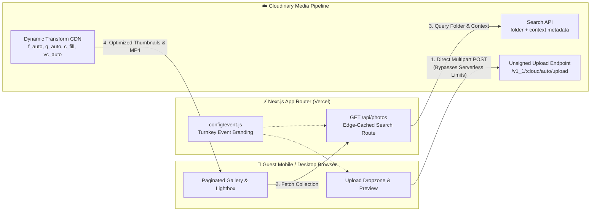

<div align="center">

# 📸 Event Photo Drop

**Turnkey QR-Ready Guest Photo & Video Sharing Portal for Live Events**

[](https://nextjs.org/)
[](https://react.dev/)
[](https://cloudinary.com/)
[](https://vercel.com/)

*Zero-app, mobile-first guest media collection and live gallery platform designed for weddings, galas, baby showers, and private events. Guests scan a QR code, drop full-resolution photos & videos straight from their camera roll, and browse the shared event collection in real time.*

</div>

---

## ✨ Architectural Highlights

- **Zero-App Frictionless Guest Flow** — Guests simply scan a venue QR code and upload directly from iOS Safari or Android Chrome without creating an account or installing an app.
- **Direct-to-Cloud Unsigned Uploads** — Media streams directly from the guest's browser to Cloudinary (`auto/upload`), bypassing serverless function payload limits (4.5 MB Vercel limit) to effortlessly support high-bitrate 4K mobile videos (`.mov`, `.mp4`) and Apple `.heic`/`.heif` photos.
- **Automatic Media Transcoding & CDN Optimization** — Server-side discovery (`/api/photos`) dynamically transforms raw uploads into `400×400` smart-cropped `f_auto,q_auto` gallery thumbnails, `1600px` lightbox views, and `full_hd` adaptive MP4 video streams.
- **100% Turnkey Branding & Configuration** — Every piece of event copy (title, tagline, venue, date, welcome message, footer, favicon emoji, and target Cloudinary folder) is controlled from a single config file ([`config/event.js`](./config/event.js)) or via environment variables—no code edits required.
- **Built-In Demo Mode** — Runs out-of-the-box on `localhost:3000` before Cloudinary credentials are connected, complete with a curated sample collection and simulated client-side uploads.
- **Editorial Hospitality Aesthetic** — Crafted with an organic stone and warm gold palette (`Playfair Display`, `Montserrat`, `Inter`), responsive masonry-style grid, full-screen keyboard/touch lightbox, and CSS `content-visibility` virtualization.

---

## 🏗️ System Architecture



---

## 🚀 Quick Start

### 1. Clone & Install

```bash
git clone https://github.com/dmrusoff/Photo.git
cd Photo
npm install
```

### 2. Configure Your Event & Cloudinary

Copy the example environment file:

```bash
cp .env.example .env.local
```

Update `.env.local` with your Cloudinary credentials and event details:

```ini
# Cloudinary Credentials
NEXT_PUBLIC_CLOUDINARY_CLOUD_NAME=your_cloud_name
NEXT_PUBLIC_CLOUDINARY_UPLOAD_PRESET=your_unsigned_upload_preset
NEXT_PUBLIC_CLOUDINARY_FOLDER=event-photos
CLOUDINARY_API_KEY=your_api_key
CLOUDINARY_API_SECRET=your_api_secret

# Event Branding (Optional — can also be edited in config/event.js)
NEXT_PUBLIC_EVENT_TAGLINE="Celebrate Together"
NEXT_PUBLIC_EVENT_TITLE="The Evening Gala"
NEXT_PUBLIC_EVENT_LOCATION="The Grand Conservatory"
NEXT_PUBLIC_EVENT_DATE="October 24, 2026"
NEXT_PUBLIC_EVENT_MESSAGE="Thank you for celebrating with us. Upload and share your favorite photos and videos captured during the event."
NEXT_PUBLIC_EVENT_FOOTER="Captured by our guests · Powered by Event Photo Drop"
NEXT_PUBLIC_EVENT_ICON="📸"
```

> **Note:** If you run `npm run dev` before configuring `.env.local`, the app automatically boots in **Demo Mode** with sample gallery photos and in-memory upload previews.

### 3. Run Locally

```bash
npm run dev
```

Open [http://localhost:3000](http://localhost:3000) to preview the portal.

---

## ☁️ Cloudinary Setup Guide (2 Minutes)

1. Sign up for a free account at [cloudinary.com](https://cloudinary.com/).
2. Copy your **Cloud Name**, **API Key**, and **API Secret** from the Cloudinary Dashboard into `.env.local`.
3. Navigate to **Settings (⚙️) → Upload → Upload Presets** and click **Add Upload Preset**:
   - **Signing Mode**: Select **Unsigned**
   - **Folder**: Set to your desired folder name (e.g., `event-photos`) or leave blank (the client passes `NEXT_PUBLIC_CLOUDINARY_FOLDER` automatically)
   - Save the preset and copy its **Preset Name** into `NEXT_PUBLIC_CLOUDINARY_UPLOAD_PRESET`.

---

## 🎨 Customizing the Aesthetic

All color tokens and typography pairings live at the top of [`app/globals.css`](./app/globals.css) inside `:root`:

| CSS Custom Property | Default Value | Purpose |
| :--- | :--- | :--- |
| `--stone-light` | `#F9F8F6` | Page background canvas |
| `--stone` | `#F0EDE9` | Borders, dividers, and skeleton placeholders |
| `--accent-gold` | `#B5A48B` | Active tab indicator, badges, and subtle highlights |
| `--neutral-900` | `#212529` | Primary CTA buttons and active pagination state |
| `--font-display` | `'Playfair Display', serif` | Hero title and section headings |
| `--font-alt` | `'Montserrat', sans-serif` | Uppercase micro-labels, metadata, and navigation |

---

## 📂 Project Structure

```text
Photo/
├── app/
│   ├── api/
│   │   └── photos/
│   │       └── route.js      # Server-side Cloudinary folder search & URL transformation
│   ├── favicon.ico
│   ├── globals.css           # Editorial hospitality design system & responsive layout
│   ├── layout.js             # Dynamic OpenGraph metadata & mobile viewport config
│   └── page.js               # Upload dropzone, batch progress, paginated gallery & lightbox
├── config/
│   └── event.js              # Central turnkey configuration with env var overrides
├── public/                   # Static SVG assets
├── .env.example              # Documented environment variable template
├── next.config.mjs           # Next.js remote image patterns
└── package.json
```

---

## 🌐 Deploying to Vercel

1. Push your repository to GitHub.
2. Import the project in [Vercel](https://vercel.com/new).
3. Paste the variables from `.env.example` into **Project Settings → Environment Variables**.
4. Click **Deploy** and generate a QR code pointing to your production domain for tabletop signage or invitations.
